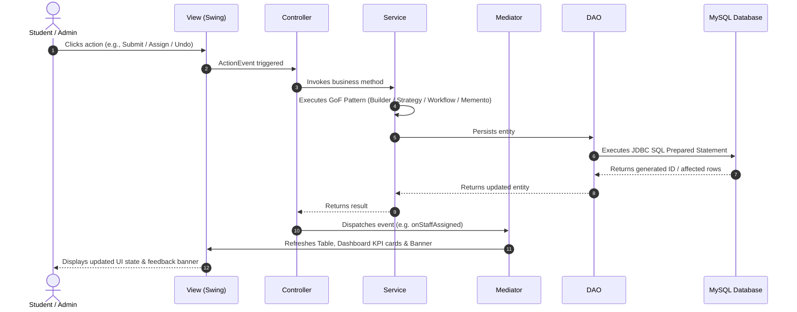
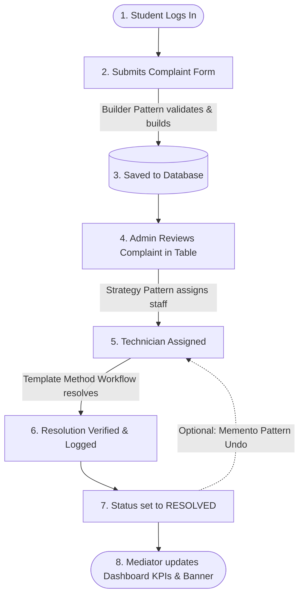
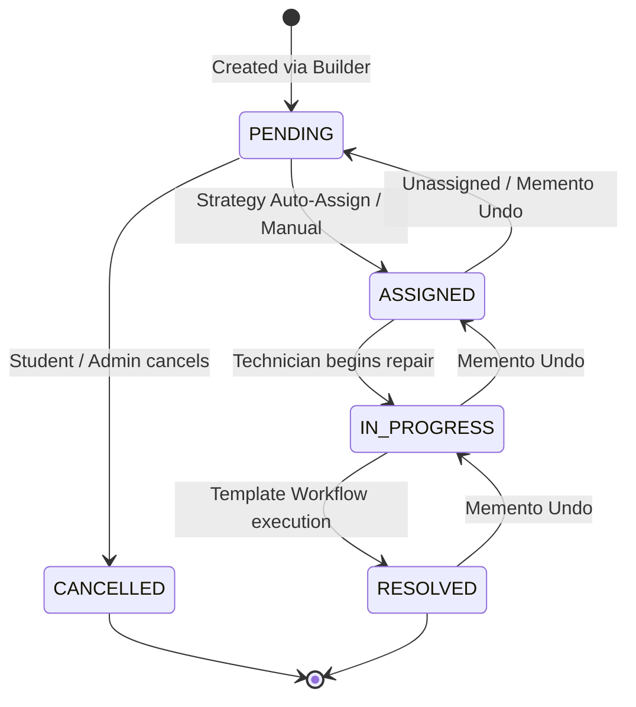
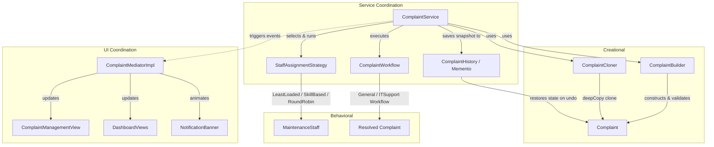

# Smart Campus Complaint & Maintenance System
### Project Overview & Teammate Guide

> A quick 3–5 minute guide to understanding the architecture, features, and design patterns of the project without reading through all the source code.

---

## 1. Project Overview

- **What is it?** A desktop application built with Java Swing and MySQL for managing university campus complaints and facility repairs.
- **Problem it solves:** Replaces manual registers and email threads with a centralized system to log issues, assign technicians, track repair lifecycles, and maintain audit records.
- **Who uses it?**
  - **Students:** Report issues, check repair progress, and clone recurring tickets.
  - **Administrators:** Review tickets, assign maintenance technicians, resolve complaints, track workloads, and undo erroneous status changes.
- **Key Highlights:** Clean MVC architecture, 6 Gang of Four (GoF) design patterns in dedicated packages, and automatic offline in-memory demo mode when MySQL is offline.

---

## 2. Technology Stack

| Component | Technology Used | Details |
|---|---|---|
| **Language & Runtime** | Java 23 | Standard SE with records, switch expressions, and modern OOP |
| **User Interface** | Java Swing + AWT | Custom light-theme design system (`AppTheme`, `CardPanel`, `StatusBadge`) |
| **Database** | MySQL 8.x | InnoDB relational schema with foreign keys, constraints, and indexes |
| **Data Connectivity** | JDBC (`mysql-connector-j` 8.3.0) | Prepared statements preventing SQL injection |
| **Offline Fallback** | In-Memory Repository | `InMemoryDatabase` fallback seeded automatically if MySQL is offline |
| **Security** | jBCrypt 0.4 | Salted BCrypt password hashing (`PasswordHasher`) |
| **Testing** | JUnit 5 (`junit-jupiter` 5.10.1) | 32 unit tests verifying patterns, services, and DAOs |
| **Build Tool** | Apache Maven 3.9+ | Standard Maven layout with executable fat JAR packaging |

---

## 3. Main Features

| Feature | What It Does |
|---|---|
| **Login & Role-Based Access** | Authenticates students and admins; dynamically shows student or admin sidebar navigation and actions. |
| **Complaint Registration** | Validates and submits complaints with title, description, category, priority, and location via a fluent builder. |
| **Status Lifecycle Tracking** | Enforces valid status transitions: `PENDING` → `ASSIGNED` → `IN_PROGRESS` → `RESOLVED` (or `CANCELLED`). |
| **Technician Assignment** | Assigns maintenance staff using selectable algorithms: *Least-Loaded*, *Skill-Based*, or *Round-Robin*. |
| **Complaint Duplication** | Clones an existing complaint into a new pending ticket with pre-filled details for recurring campus issues. |
| **Undo / State Rollback** | Restores the previous status, staff assignment, or description of a complaint using snapshot history. |
| **KPI Dashboards** | Displays metric counters for Total, Pending, In Progress, and Resolved tickets for students and administrators. |
| **Staff & Skill Management** | Allows administrators to register technicians, view active workloads, and configure category skillsets. |

---

## 4. System Architecture

The application strictly follows the **Model-View-Controller (MVC)** architectural pattern layered over a **Service Layer** and **Data Access Object (DAO)** layer:

- **Model (`com.campus.complaints.model`):** Plain domain objects (`Complaint`, `User`, `Student`, `MaintenanceStaff`) that store application state and validate lifecycle transitions (`ComplaintStatus.canTransitionTo`).
- **View (`com.campus.complaints.mvc.view`):** Swing panels (`LoginView`, `MainFrame`, `ComplaintManagementView`, `ComplaintDetailsView`, `ComplaintFormView`) that display data and capture user clicks. Views contain no SQL or business logic.
- **Controller (`com.campus.complaints.mvc.controller`):** Intermediaries (`LoginController`, `ComplaintController`, `DashboardController`, `StaffController`) that handle UI events, validate inputs, invoke services, and notify the Mediator.
- **Service Layer (`com.campus.complaints.service`):** Business operations orchestrating design patterns (`ComplaintService`, `StaffAssignmentService`, `AuthenticationService`, `DashboardService`).
- **DAO Layer (`com.campus.complaints.dao`):** Database queries using JDBC (`ComplaintDAOImpl`, `UserDAOImpl`, `MaintenanceStaffDAOImpl`) with an automatic offline fallback (`InMemoryDatabase`).

### System Interaction Diagram



---

## 5. Design Patterns and Their Implementations

All 6 GoF design patterns live in their own dedicated packages under `com.campus.complaints.designpatterns.*`:

| Design Pattern | Class & File Path | Purpose & What It Does | Concrete Example in This Project |
|---|---|---|---|
| **Builder** *(Creational)* | [`ComplaintBuilder.java`](file:///d:/DP_mini_project/src/main/java/com/campus/complaints/designpatterns/builder/ComplaintBuilder.java)<br>`designpatterns.builder` | • Constructs complex complaints step-by-step.<br>• Validates all mandatory fields before instantiation in `build()`. | Used in `ComplaintService.submitComplaint()` when a student submits a ticket via `ComplaintFormView`, and in `ComplaintDAOImpl.mapRow()`. |
| **Prototype** *(Creational)* | [`ComplaintPrototype.java`](file:///d:/DP_mini_project/src/main/java/com/campus/complaints/designpatterns/prototype/ComplaintPrototype.java)<br>[`ComplaintCloner.java`](file:///d:/DP_mini_project/src/main/java/com/campus/complaints/designpatterns/prototype/ComplaintCloner.java)<br>`designpatterns.prototype` | • Clones complaints for recurring issues.<br>• Resets ID (`0`), status (`PENDING`), and clears staff while copying description and category. | Used when clicking **Duplicate** in `ComplaintManagementView` or `ComplaintDetailsView` via `ComplaintController.duplicateComplaint()`. |
| **Mediator** *(Behavioral)* | [`ComplaintMediator.java`](file:///d:/DP_mini_project/src/main/java/com/campus/complaints/designpatterns/mediator/ComplaintMediator.java)<br>[`ComplaintMediatorImpl.java`](file:///d:/DP_mini_project/src/main/java/com/campus/complaints/designpatterns/mediator/ComplaintMediatorImpl.java)<br>`designpatterns.mediator` | • Centralizes communication between Swing views.<br>• Eliminates direct N-to-N view coupling when events occur. | When a ticket is submitted or assigned, `mediator.onComplaintSubmitted()` simultaneously updates the Table, Dashboard cards, and Notification banner. |
| **Template Method** *(Behavioral)* | [`ComplaintWorkflow.java`](file:///d:/DP_mini_project/src/main/java/com/campus/complaints/designpatterns/template/ComplaintWorkflow.java)<br>[`ITSupportWorkflow.java`](file:///d:/DP_mini_project/src/main/java/com/campus/complaints/designpatterns/template/ITSupportWorkflow.java)<br>[`GeneralMaintenanceWorkflow.java`](file:///d:/DP_mini_project/src/main/java/com/campus/complaints/designpatterns/template/GeneralMaintenanceWorkflow.java)<br>`designpatterns.template` | • Defines a `final` 5-step resolution algorithm skeleton.<br>• Subclasses customize verification, notes validation, and auditing. | Used in `ComplaintService.resolveComplaint()`. `ITSupportWorkflow` enforces non-empty technical notes for `NETWORK` / `IT_SUPPORT` complaints. |
| **Strategy** *(Behavioral)* | [`StaffAssignmentStrategy.java`](file:///d:/DP_mini_project/src/main/java/com/campus/complaints/designpatterns/strategy/StaffAssignmentStrategy.java)<br>[`LeastLoadedStaffStrategy.java`](file:///d:/DP_mini_project/src/main/java/com/campus/complaints/designpatterns/strategy/LeastLoadedStaffStrategy.java)<br>[`SkillBasedAssignmentStrategy.java`](file:///d:/DP_mini_project/src/main/java/com/campus/complaints/designpatterns/strategy/SkillBasedAssignmentStrategy.java)<br>[`RoundRobinAssignmentStrategy.java`](file:///d:/DP_mini_project/src/main/java/com/campus/complaints/designpatterns/strategy/RoundRobinAssignmentStrategy.java)<br>`designpatterns.strategy` | • Defines a family of technician assignment algorithms.<br>• Allows the administrator to switch algorithms dynamically at runtime. | In `ComplaintDetailsView`, clicking **Assign Staff** opens a dialog letting the admin pick *Least-Loaded*, *Skill-Based*, or *Round-Robin*. |
| **Memento** *(Behavioral)* | [`ComplaintMemento.java`](file:///d:/DP_mini_project/src/main/java/com/campus/complaints/designpatterns/memento/ComplaintMemento.java)<br>[`ComplaintHistory.java`](file:///d:/DP_mini_project/src/main/java/com/campus/complaints/designpatterns/memento/ComplaintHistory.java)<br>`designpatterns.memento` | • Captures immutable complaint state snapshots.<br>• Restores previous state on undo without violating encapsulation. | In `ComplaintDetailsView`, clicking **Undo Last Change** pops the top memento from `ComplaintHistory` and reverts status/assignment in DB and UI. |
| **MVC** *(Architectural)* | Package groups:<br>`mvc.model`, `mvc.view`, `mvc.controller` | • Separates data structure, Swing presentation, and user control logic. | The entire GUI structure is split into dedicated packages for views, controllers, and services. |

---

## 6. Important Classes

| Package | Class | Responsibility |
|---|---|---|
| `com.campus.complaints` | [`CampusComplaintApplication`](file:///d:/DP_mini_project/src/main/java/com/campus/complaints/CampusComplaintApplication.java) | Main entry point; tests DB connection, starts demo fallback if needed, wires MVC, and starts GUI. |
| `model` | [`Complaint`](file:///d:/DP_mini_project/src/main/java/com/campus/complaints/model/Complaint.java) | Canonical domain entity representing a ticket; implements `ComplaintPrototype.deepCopy()`. |
| `model` | [`MaintenanceStaff`](file:///d:/DP_mini_project/src/main/java/com/campus/complaints/model/MaintenanceStaff.java) | Represents technician data, active ticket count, availability, and category skillsets. |
| `service` | [`ComplaintService`](file:///d:/DP_mini_project/src/main/java/com/campus/complaints/service/ComplaintService.java) | Coordinates Builder submission, Prototype cloning, Memento undo, and Workflow execution. |
| `service` | [`StaffAssignmentService`](file:///d:/DP_mini_project/src/main/java/com/campus/complaints/service/StaffAssignmentService.java) | Encapsulates Strategy pattern execution for assigning staff. |
| `service` | [`AuthenticationService`](file:///d:/DP_mini_project/src/main/java/com/campus/complaints/service/AuthenticationService.java) | Handles login verification using `PasswordHasher` and tracks session state. |
| `mvc.controller` | [`ComplaintController`](file:///d:/DP_mini_project/src/main/java/com/campus/complaints/mvc/controller/ComplaintController.java) | Manages list filtering, ticket submission, strategy assignment, resolve, and undo flows. |
| `mvc.view` | [`MainFrame`](file:///d:/DP_mini_project/src/main/java/com/campus/complaints/mvc/view/MainFrame.java) | Window shell with role-aware sidebar navigation and notification banner. |
| `mvc.view` | [`ComplaintManagementView`](file:///d:/DP_mini_project/src/main/java/com/campus/complaints/mvc/view/ComplaintManagementView.java) | Searchable and filterable table with action buttons (*View Details*, *Duplicate*). |
| `mvc.view` | [`ComplaintDetailsView`](file:///d:/DP_mini_project/src/main/java/com/campus/complaints/mvc/view/ComplaintDetailsView.java) | Detailed view with action buttons (*Assign Staff*, *Change Status*, *Resolve*, *Undo*). |
| `dao.impl` | [`ComplaintDAOImpl`](file:///d:/DP_mini_project/src/main/java/com/campus/complaints/dao/impl/ComplaintDAOImpl.java) | JDBC repository executing SQL queries and reconstructing complaints via `ComplaintBuilder`. |
| `dao.inmemory` | [`InMemoryDatabase`](file:///d:/DP_mini_project/src/main/java/com/campus/complaints/dao/inmemory/InMemoryDatabase.java) | Zero-setup in-memory repository providing 100% functionality when MySQL is offline. |

---

## 7. How the Application Works (End-to-End Flow)



1. **Student Login:** Student signs in (`alice@student.edu` / `student123`). The `LoginController` validates credentials via `AuthenticationService`.
2. **Submit Complaint (Builder Pattern):** Student fills the form (`ComplaintFormView`). `ComplaintBuilder` validates mandatory fields and builds the `Complaint`.
3. **Database Persistence:** `ComplaintService` saves the ticket via `ComplaintDAOImpl` (or `InMemoryDatabase`).
4. **Mediator Notification:** `ComplaintMediatorImpl` immediately refreshes the student's dashboard counters and displays a success banner.
5. **Admin Review:** Admin signs in (`admin@campus.edu` / `admin123`) and opens `ComplaintManagementView`.
6. **Assign Technician (Strategy Pattern):** Admin clicks *Assign Staff* on `ComplaintDetailsView`. Admin picks *Skill-Based Assignment*. The selected strategy matches category skills and assigns the best technician.
7. **Resolution Workflow (Template Method Pattern):** Admin clicks *Resolve Complaint*. `ComplaintWorkflow.processComplaint()` validates eligibility, verifies notes (enforcing technical notes if IT), transitions state to `RESOLVED`, and logs an audit.
8. **Undo Support (Memento Pattern):** If an admin made an erroneous status transition, clicking *Undo Last Change* restores the prior snapshot from `ComplaintHistory`.

---

## 8. Key Diagrams

### 8.1 Complaint Status Lifecycle



### 8.2 Design Patterns Integration Map



---

## 9. Running the Project

### Quick Start (Pre-Built JAR)
```bash
java -jar target/CampusComplaintSystem.jar
```

### Build & Run from Source (Maven)
```bash
# 1. Compile and execute via Maven
mvn compile exec:java -Dexec.mainClass="com.campus.complaints.CampusComplaintApplication"

# 2. Or build the fat executable JAR
mvn clean package -DskipTests
java -jar target/CampusComplaintSystem.jar
```

### Run Automated Unit Tests (32 Tests)
```bash
mvn test
```

### Default Credentials
| Role | User Name | Login Email | Password | Preloaded Complaints |
|---|---|---|---|---|
| **Administrator** | Campus Administrator | `admin@campus.edu` | `admin123` | All campus complaints |
| **Student 1** | Student 1 | `student1@campus.edu` | `student123` | 2 complaints (Wi-Fi, Water Leakage) |
| **Student 2** | Student 2 | `student2@campus.edu` | `student123` | 3 complaints (Ceiling Fan, Projector, Lights) |

> **Offline Demo Mode:** If MySQL is not running on `localhost:3306`, the application automatically detects connection failure and starts in **In-Memory Demo Mode** with preloaded campus data. Everything works 100% out of the box with zero setup needed!
