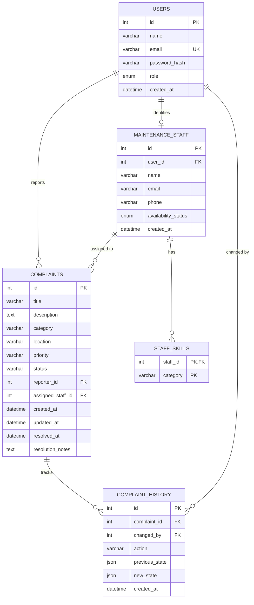

# Database Design Specification

The system uses a relational database schema designed for MySQL 8.x, ensuring strict referential integrity, indexing for fast filtering, and JSON persistence for the Memento pattern.

---

## Entity Relationship (ER) Diagram

---

## Tables Description

### 1. `users`
Stores student and administrator credentials. Passwords are encrypted using BCrypt ($2a$).

| Column | Type | Constraints | Description |
|---|---|---|---|
| `id` | `INT UNSIGNED` | `PRIMARY KEY, AUTO_INCREMENT` | Unique user identifier |
| `name` | `VARCHAR(150)` | `NOT NULL` | Full legal name |
| `email` | `VARCHAR(255)` | `NOT NULL, UNIQUE` | University login email |
| `password_hash` | `VARCHAR(255)` | `NOT NULL` | BCrypt password hash |
| `role` | `ENUM('STUDENT','ADMIN')` | `NOT NULL, DEFAULT 'STUDENT'` | Access control role |
| `created_at` | `DATETIME` | `NOT NULL, DEFAULT CURRENT_TIMESTAMP` | Account creation timestamp |

### 2. `maintenance_staff`
Stores maintenance personnel linked to system user profiles.

| Column | Type | Constraints | Description |
|---|---|---|---|
| `id` | `INT UNSIGNED` | `PRIMARY KEY, AUTO_INCREMENT` | Unique staff ID |
| `user_id` | `INT UNSIGNED` | `NOT NULL, UNIQUE, FK -> users(id)` | Linked user account |
| `name` | `VARCHAR(150)` | `NOT NULL` | Technician display name |
| `email` | `VARCHAR(255)` | `NOT NULL` | Contact email |
| `phone` | `VARCHAR(20)` | `NULL` | Mobile contact number |
| `availability_status`| `ENUM('AVAILABLE','UNAVAILABLE','ON_LEAVE')` | `NOT NULL, DEFAULT 'AVAILABLE'` | Current work status |
| `created_at` | `DATETIME` | `NOT NULL, DEFAULT CURRENT_TIMESTAMP` | Onboarding timestamp |

### 3. `staff_skills`
Maps technician competencies to complaint categories for the `SkillBasedAssignmentStrategy`.

| Column | Type | Constraints | Description |
|---|---|---|---|
| `staff_id` | `INT UNSIGNED` | `NOT NULL, FK -> maintenance_staff(id)` | Staff member |
| `category` | `VARCHAR(50)` | `NOT NULL` | Matching category enum name |

### 4. `complaints`
Central repository for campus complaints.

| Column | Type | Constraints | Description |
|---|---|---|---|
| `id` | `INT UNSIGNED` | `PRIMARY KEY, AUTO_INCREMENT` | Complaint tracking number |
| `title` | `VARCHAR(255)` | `NOT NULL` | Issue summary |
| `description` | `TEXT` | `NOT NULL` | Detailed incident description |
| `category` | `VARCHAR(50)` | `NOT NULL` | NETWORK, ELECTRICAL, PLUMBING, etc. |
| `location` | `VARCHAR(200)` | `NOT NULL` | Room, lab, or campus block |
| `priority` | `VARCHAR(20)` | `NOT NULL, DEFAULT 'MEDIUM'` | LOW, MEDIUM, HIGH, CRITICAL |
| `status` | `VARCHAR(30)` | `NOT NULL, DEFAULT 'PENDING'` | PENDING, ASSIGNED, IN_PROGRESS, RESOLVED, CANCELLED |
| `reporter_id` | `INT UNSIGNED` | `NOT NULL, FK -> users(id)` | Submitting student |
| `assigned_staff_id` | `INT UNSIGNED` | `NULL, FK -> maintenance_staff(id)` | Assigned technician |
| `created_at` | `DATETIME` | `NOT NULL, DEFAULT CURRENT_TIMESTAMP` | Submission timestamp |
| `updated_at` | `DATETIME` | `NOT NULL, DEFAULT CURRENT_TIMESTAMP` | Last updated timestamp |
| `resolved_at` | `DATETIME` | `NULL` | Completion timestamp |
| `resolutionNotes` | `TEXT` | `NULL` | Technical resolution summary |

### 5. `complaint_history` (Memento Pattern Storage)
Stores state snapshots before each modification to facilitate undo actions across application restarts.

| Column | Type | Constraints | Description |
|---|---|---|---|
| `id` | `INT UNSIGNED` | `PRIMARY KEY, AUTO_INCREMENT` | Audit entry ID |
| `complaint_id` | `INT UNSIGNED` | `NOT NULL, FK -> complaints(id)` | Target complaint |
| `changed_by` | `INT UNSIGNED` | `NOT NULL, FK -> users(id)` | Responsible user |
| `action` | `VARCHAR(100)` | `NOT NULL` | STAFF_ASSIGNMENT, STATUS_CHANGE, etc. |
| `previous_state`| `JSON` | `NOT NULL` | Complete Memento serialized snapshot |
| `new_state` | `JSON` | `NULL` | State after modification |
| `created_at` | `DATETIME` | `NOT NULL, DEFAULT CURRENT_TIMESTAMP` | History timestamp |
