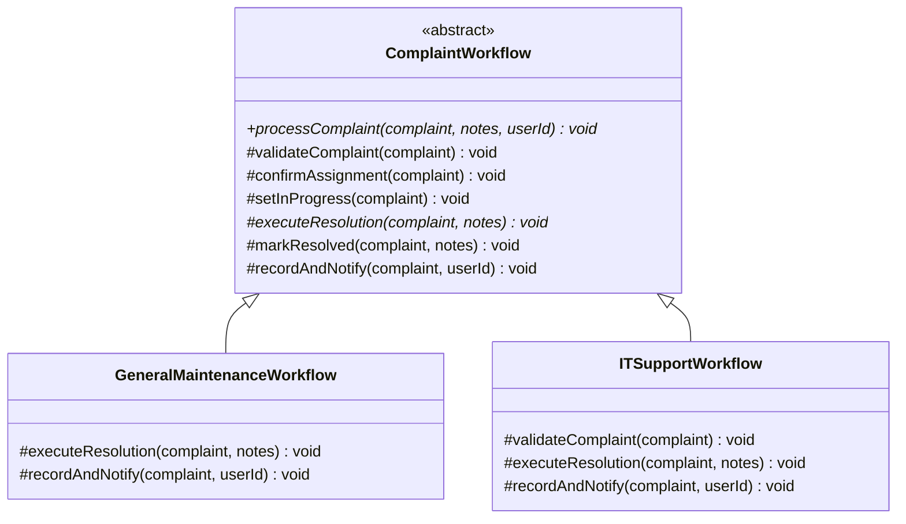
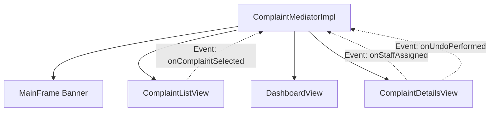

# GoF Design Patterns Implementation Guide

This document details the practical implementation of six Gang of Four (GoF) design patterns in the **Smart Campus Complaint & Maintenance System**.

---

## 1. Builder Pattern (Creational)

### Intent
Separate the construction of a complex object from its representation so that the same construction process can create different representations.

### Campus Problem Solved
A `Complaint` has numerous mandatory attributes (title, description, category, location, priority, reporter) and multiple optional lifecycle attributes (id, assigned staff, status, timestamps, resolution notes). Using telescoping constructors leads to fragile, unreadable code.

### Implementation
- **Class**: [`Complaint.java`](file:///d:/DP_mini_project/src/main/java/com/campus/complaints/model/Complaint.java)
- **Static Inner Builder**: `Complaint.Builder`
- **Enforcement**: The private `Complaint()` constructor prevents direct instantiation outside the builder.
- **Validation**: The `build()` method validates all required fields before instantiating the object, throwing descriptive `IllegalStateException` on failure.

```java
Complaint complaint = new Complaint.Builder()
        .title("Wi-Fi Router Offline")
        .description("Students in Library 2F cannot connect to Campus_Secure")
        .category(ComplaintCategory.NETWORK)
        .location("Central Library, 2nd Floor")
        .priority(Priority.HIGH)
        .reporterId(studentUser.getId())
        .build();
```

---

## 2. Prototype Pattern (Creational)

### Intent
Specify the kinds of objects to create using a prototypical instance, and create new objects by copying this prototype.

### Campus Problem Solved
Campus maintenance issues frequently reoccur in adjacent classrooms, laboratories, or wings (e.g., standard projector faults, air conditioning leaks, sanitation requests). The **Duplicate Complaint** feature allows students or staff to clone an existing complaint with pre-filled category, description, and location template, avoiding repetitive manual entry.

### Implementation
- **Class**: [`Complaint.java`](file:///d:/DP_mini_project/src/main/java/com/campus/complaints/model/Complaint.java)
- **Method**: `deepCopy()`
- **Lifecycle Reset**: The cloned instance generates a clean identity:
  - Resets `id` to `0` (unsaved)
  - Resets `status` to `ComplaintStatus.PENDING`
  - Unsets `assignedStaffId`, `resolvedAt`, and `resolutionNotes`
  - Appends `" (Copy)"` to the title
  - Retains core complaint properties (category, description, priority, location)

```java
// User selects an existing complaint and clicks "Duplicate"
Complaint cloned = selectedComplaint.deepCopy();
// The form pre-fills with cloned fields, allowing quick adjustments before saving
```

---

## 3. Strategy Pattern (Behavioral)

### Intent
Define a family of algorithms, encapsulate each one, and make them interchangeable. Strategy lets the algorithm vary independently from clients that use it.

### Campus Problem Solved
Assigning complaints to maintenance staff depends on operational policies:
1. Workload balancing to prevent technician burnout.
2. Skill specialization for technical tasks (network, electrical, plumbing).
3. Fair round-robin distribution during peak operational hours.

### Implementation
- **Interface**: [`StaffAssignmentStrategy.java`](file:///d:/DP_mini_project/src/main/java/com/campus/complaints/strategy/StaffAssignmentStrategy.java)
- **Concrete Strategies**:
  - [`LeastLoadedStaffStrategy.java`](file:///d:/DP_mini_project/src/main/java/com/campus/complaints/strategy/LeastLoadedStaffStrategy.java): Selects the available staff member with the fewest active complaints.
  - [`RoundRobinAssignmentStrategy.java`](file:///d:/DP_mini_project/src/main/java/com/campus/complaints/strategy/RoundRobinAssignmentStrategy.java): Cycles through staff in order of ID using an atomic index counter.
  - [`SkillBasedAssignmentStrategy.java`](file:///d:/DP_mini_project/src/main/java/com/campus/complaints/strategy/SkillBasedAssignmentStrategy.java): Matches the complaint's category with the technician's certified skills, picking the least-loaded matching technician.
- **Context**: [`ComplaintService.java`](file:///d:/DP_mini_project/src/main/java/com/campus/complaints/service/ComplaintService.java) allows runtime strategy swapping via UI dropdown.

```java
complaintService.setAssignmentStrategy(new SkillBasedAssignmentStrategy());
Optional<MaintenanceStaff> staff = complaintService.autoAssignStaff(complaint, adminUserId);
```

---

## 4. Template Method Pattern (Behavioral)

### Intent
Define the skeleton of an algorithm in an operation, deferring some steps to subclasses. Template Method lets subclasses redefine certain steps of an algorithm without changing the algorithm's structure.

### Campus Problem Solved
Resolving a complaint requires a strict governance workflow (validation &rarr; verify staff assignment &rarr; transition to in-progress &rarr; execute specialized resolution check &rarr; record status and timestamps &rarr; notify stakeholder). However, IT/Network complaints require specialized diagnostics validation, whereas general maintenance requires physical work sign-offs.

### Implementation
- **Abstract Class**: [`ComplaintWorkflow.java`](file:///d:/DP_mini_project/src/main/java/com/campus/complaints/template/ComplaintWorkflow.java)
  - `final void processComplaint(Complaint, String, int)` enforces the step sequence.
- **Concrete Subclasses**:
  - [`GeneralMaintenanceWorkflow.java`](file:///d:/DP_mini_project/src/main/java/com/campus/complaints/template/GeneralMaintenanceWorkflow.java): Validates physical maintenance completion descriptions.
  - [`ITSupportWorkflow.java`](file:///d:/DP_mini_project/src/main/java/com/campus/complaints/template/ITSupportWorkflow.java): Enforces IT-specific resolution notes (e.g. VLAN configurations, hardware swap serials, driver resets).



---

## 5. Mediator Pattern (Behavioral)

### Intent
Define an object that encapsulates how a set of objects interact. Mediator promotes loose coupling by keeping objects from referring to each other explicitly, and it lets you vary their interaction independently.

### Campus Problem Solved
In a rich Swing GUI application, actions in one view (e.g. submitting a complaint, changing a status in the details dialog, assigning a technician in the staff panel) need to notify multiple UI components:
- The dashboard statistics cards.
- The complaint list table.
- The detail view panel.
- The main window notification banner.

Without a Mediator, views would directly reference and update each other, creating a tangled dependency web.

### Implementation
- **Interface**: [`ComplaintMediator.java`](file:///d:/DP_mini_project/src/main/java/com/campus/complaints/mediator/ComplaintMediator.java)
- **Concrete Mediator**: [`ComplaintMediatorImpl.java`](file:///d:/DP_mini_project/src/main/java/com/campus/complaints/mediator/ComplaintMediatorImpl.java)
- **Coordinated Peers**: `MainFrame`, `ComplaintListView`, `AdminDashboardView`, `StudentDashboardView`, `ComplaintDetailsView`.



---

## 6. Memento Pattern (Behavioral)

### Intent
Without violating encapsulation, capture and externalize an object's internal state so that the object can be restored to this state later.

### Campus Problem Solved
Administrators frequently make accidental status updates or assign the wrong technician. The **Undo Last Change** capability allows reverting a complaint to its exact prior state.

### Implementation
- **Memento**: [`ComplaintMemento.java`](file:///d:/DP_mini_project/src/main/java/com/campus/complaints/memento/ComplaintMemento.java) — Immutable snapshot storing `status`, `assignedStaffId`, `description`, `resolutionNotes`, `timestamp`, `changedByUserId`, and `actionLabel`.
- **Caretaker**: [`ComplaintHistory.java`](file:///d:/DP_mini_project/src/main/java/com/campus/complaints/memento/ComplaintHistory.java) — In-memory stack managing undo history with size limiting.
- **Persistence Extension**: [`ComplaintHistoryDAO.java`](file:///d:/DP_mini_project/src/main/java/com/campus/complaints/dao/ComplaintHistoryDAO.java) writes snapshot JSON records to the MySQL `complaint_history` table, ensuring undo stacks survive application restarts!

```java
// Captures previous state into Memento before mutating
captureMemento(complaint, userId, "STAFF_ASSIGNMENT");
complaint.setAssignedStaffId(staffId);
complaintDAO.update(complaint);

// Rollback restores exact snapshot
public boolean undoLastChange(Complaint complaint, int userId) {
    ComplaintMemento memento = history.pop();
    complaint.setStatus(memento.getStatus());
    complaint.setAssignedStaffId(memento.getAssignedStaffId());
    complaintDAO.update(complaint);
    return true;
}
```
